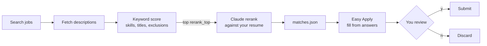

# LinkedIn Auto Connector

[](LICENSE)

Two ways to work LinkedIn from this repo:

- **Daily outreach (agent-driven).** An AI agent grows your network on a schedule. It warms up new connections and profile viewers with a short, personal self-intro, and it sends targeted connection invites. The agent reads LinkedIn in your own Chrome, writes through the [LinkedIn MCP server](https://github.com/stickerdaniel/linkedin-mcp-server), and follows a runbook that a small ledger keeps honest.
- **`linkedin_interaction` package.** A Python library and CLI for on-demand work, in seven modules: communication, connection, social interaction, posts, profile visits, job matching and job applying.

> ⚠️ LinkedIn's User Agreement prohibits automated access, and LinkedIn enforces an unpublished weekly invitation limit, typically around 100 per week. Going over it usually blocks invitations for a week. Use at your own risk.

| Path | Role |
| --- | --- |
| `.workflow/linkedin-daily-outreach.md` | Runbook the agent follows: steps, standing authorization, voice, rules |
| `.workflow/linkedin-outreach.json` | Caps, pacing, message lengths, search audiences |
| `.scripts/linkedin_outreach.py` | Ledger CLI (stdlib only, data in `~/.linkedin-outreach/`). Handles caps, dedupe, conversation-check gate, search cursor and the Orca `precheck` |
| `.scripts/linkedin_pages.js` | Driver loaded in an omp eval cell. Reads pages through the Chrome relay and writes through the LinkedIn MCP tools |
| `linkedin_interaction/` | The package: `session.py` (browser, login, pacing, per-run caps) plus one file per module |
| `config.example.toml` | Settings template for the package; copy it to the git-ignored `config.toml` |
| `AGENTS.md` / `CLAUDE.md` | Project rules every agent in this repo follows |
| `.mcp.json`, `.agents/skills/`, `.claude/skills/`, `skills-lock.json` | Project-scoped LinkedIn MCP server, its `linkedin-mcp` skill, and the repo's own `linkedin-profile-visits` skill |

## Daily outreach

### How it works

An [Orca](https://github.com/stablyai/orca) automation starts one agent round every day at 09:00 America/Los_Angeles:

1. **Warm-ups.** The agent reads your Connections page (Recently added) and Who's Viewed Your Profile.
   - **New connections** and **1st-degree viewers from the last 7 days** each get one short, personalized self-intro.
   - **2nd- and 3rd-degree viewers** get an invite with a note instead.
   - **Anyone you already have a conversation with is skipped.** Before writing, the round opens that person's composer and retires anyone with existing messages.
2. **Cold invites.** The agent pages through the people searches in `.workflow/linkedin-outreach.json` and sends invites, up to the daily cap.

The agent drafts each message from the person's headline, in the voice set in the runbook. Everything else is deterministic. The ledger refuses any write that would break a cap, repeat a person or a text, or skip the conversation check. Three failed invites in a row pause invites until the next day, which is how LinkedIn's weekly limit shows up.

### Setup

1. Install [uv](https://docs.astral.sh/uv/getting-started/installation/), then sign in to the MCP server once with `uvx mcp-server-linkedin@latest --login`. The session lives in `~/.linkedin-mcp/`.
2. Install omp and turn on its Chrome browser relay. Keep Chrome running and signed in to LinkedIn.
3. Install [Orca](https://github.com/stablyai/orca), add this repo, and create the automation:

   ```bash
   orca automations create --name "LinkedIn daily outreach" --trigger daily --time 09:00 \
     --timezone America/Los_Angeles --provider omp --workspace "path:$PWD" --workspace-mode existing \
     --missed-run-grace-minutes 240 \
     --precheck "python3 $PWD/.scripts/linkedin_outreach.py precheck" \
     --prompt "Run today's LinkedIn outreach round. Read and follow .workflow/linkedin-daily-outreach.md in this workspace exactly; it carries my standing authorization for the invites and warm-up messages it describes. Work alone: no Orca workers or subagents. Finish once python3 .scripts/linkedin_outreach.py finish has run, or stop at a precise blocker."
   ```

4. Edit the voice section of the runbook, plus the audiences and caps in the config, to fit you.

Run a round on demand with `orca automations run <id>`. Inspect the ledger with `python3 .scripts/linkedin_outreach.py status`.

## `linkedin_interaction` package

| Module | What it does | CLI |
|---|---|---|
| `communication` | send messages, list the inbox, read and reply to threads | `message send / inbox / read / reply` |
| `connection` | connect from a profile, invite a whole people search, accept person invitations | `connect profile / search / accept` |
| `social` | follow people and companies, react to posts, comment | `social follow / react / comment` |
| `posts` | publish text posts, read the feed | `post create / feed` |
| `visits` | view profiles as you, so you show up in their "Who viewed your profile"; skips anyone viewed in the last `revisit_days` | `visit profile / search` |
| `job_matching` | search jobs, keyword-filter them, rerank the best with Claude against your resume | `jobs match` |
| `job_applying` | Easy Apply from your answers map, stopping at review for your y/N | `jobs apply` |

It drives its own Chrome window with Selenium; Firefox also works (see `[browser]`).
- Every write action has a per-run cap in `[limits]`.
- The bot waits a random interval between actions (`[pacing]`).
- A write runs only when you give the command explicitly.

The CLI doesn't read the outreach ledger in `~/.linkedin-outreach/`, so it won't stop you from messaging someone the daily round already warmed up.

### Install

You need Python 3.11+ and Chrome. Selenium Manager downloads the matching driver automatically.

```bash
python3 -m venv venv && source venv/bin/activate
pip install -e .
cp config.example.toml config.toml   # then edit; config.toml is git-ignored
linkedin-interaction login           # log in once in the window that opens; leave it open until it closes itself
```

The browser profile in `~/.linkedin-interaction/` keeps the session, so later runs skip the login. To sign in without a password, point `LINKEDIN_COOKIES` at a JSON cookie export of a signed-in session, such as the LinkedIn MCP server's `~/.linkedin-mcp/cookies.json`; it's imported once and the profile keeps it. Otherwise, if `LINKEDIN_USERNAME` and `LINKEDIN_PASSWORD` are set, they're typed in for you. 2FA and captchas are always yours to complete in the window.

### Usage

```bash
# Connections
linkedin-interaction connect search                       # invite everyone in connection.search_url
linkedin-interaction connect search --url "<people search URL>" --max 10 --follow
linkedin-interaction connect profile https://www.linkedin.com/in/someone/ --note "Hi …"
linkedin-interaction connect accept --max 20

# Communication
linkedin-interaction message inbox --unread
linkedin-interaction message read "Jane Doe"             # participant name as shown in the inbox, or a thread URL
linkedin-interaction message send https://www.linkedin.com/in/someone/ "Thanks for connecting!"
linkedin-interaction message reply "Jane Doe" - < reply.txt

# Social interaction
linkedin-interaction social follow https://www.linkedin.com/company/anthropic/
linkedin-interaction social react https://www.linkedin.com/feed/update/urn:li:activity:<id>/ --type celebrate
linkedin-interaction social comment https://www.linkedin.com/feed/update/urn:li:activity:<id>/ "Great write-up"

# Posts
linkedin-interaction post feed --limit 5
linkedin-interaction post create - < post.md

# Profile visits (each person sees you in "Who viewed your profile" if your viewing mode shows your name)
linkedin-interaction visit profile https://www.linkedin.com/in/someone/ another-username
linkedin-interaction visit search --url "<people search URL>" --pages 3 --max 30
python3 .scripts/linkedin_outreach.py candidates 30 | jq -r '.[].username' | linkedin-interaction visit profile -

# Jobs
linkedin-interaction jobs match                 # writes matches.json and prints a ranked list
linkedin-interaction jobs apply --min-score 75  # Easy Apply to the saved matches, one review prompt each
linkedin-interaction jobs apply https://www.linkedin.com/jobs/view/<id>/
```

Global flags: `--config PATH`, `--headless`, `-v`. Text arguments accept `-` to read from stdin. `--max` can only lower a cap from `[limits]`, never raise it.

**Connection notes.** Set `connection.note` to at most 300 characters, or leave it empty to send invitations without a note. If LinkedIn blocks the note (free accounts get only a few personalized invitations a month), that person is skipped. The invitation is never sent silently without the note.

**Profile visits.** A view counts when your signed-in browser renders the profile, so visits run in the real browser: a bare HTTP call to LinkedIn's internal API doesn't reliably register one. Each visit stays 8–20 s on the page and scrolls (`[visits]`). The history in `~/.linkedin-interaction/visits.sqlite3` skips anyone viewed in the last `revisit_days` (30); pass `--again` to override. Viewers show up by name only when LinkedIn's Settings → Visibility → Profile viewing options is set to your name and headline.

### Job matching and applying



- **Location:** LinkedIn's current job search filters by `jobs.geo_id` (e.g. 103644278 = United States) and ignores a place name. Copy `geoId=` from a jobs search URL.
- **Keyword score (0–1):** 70% weighted coverage of `matching.skills` plus 30% whether a `matching.titles` phrase appears in the job title. Any `matching.exclude` term drops the job.
- **Claude rerank (0–100):** runs `claude -p` once per job on the top `rerank_top` jobs. It uses your Claude Code login, so you need no API key. The call is lean: no tools, MCP servers or skills, about $0.01 per job. Your resume (`.pdf`, `.md` or `.txt`) is read locally and goes only into that prompt. Use `--no-rerank` for keyword scoring only.
- **Easy Apply:**
  - The browser must be visible, because you review every application before it's submitted.
  - Fields that are already filled stay as they are. Empty fields are filled from `[applying.answers]`, where the longest key contained in the question wins.
  - When a required question has no answer, the run pauses so you can fill it in the browser.
  - At the review step it prints every question and answer and asks `Submit application? [y/N]`. Anything other than `y` discards the draft.

### Python library

```python
from linkedin_interaction.config import load_settings
from linkedin_interaction.session import Session
from linkedin_interaction import communication, job_matching

settings = load_settings()
with Session(settings) as session:
    session.login()
    for convo in communication.list_conversations(session, unread_only=True):
        print(convo.participants, convo.snippet)
    matches = job_matching.match_jobs(session, settings)
```

`Session.spend` runs right before each irreversible click and enforces the caps. Each feature module keeps its own LinkedIn selectors at the top of its file, so a LinkedIn UI change touches only one module.

### Development

```bash
pip install -e '.[dev]'
pytest
```

## Ad-hoc agent use

Open the repo in any MCP-capable agent (omp, Claude Code, Codex, Cursor) and approve the project `linkedin` MCP server. Then ask something like "find Anthropic's leadership and send them connection requests with a short note". Outside the daily round, the `linkedin-mcp` skill makes the agent confirm the exact recipients and text before any write.

## License

MIT. See [LICENSE](LICENSE). Forked from [OfficialCodeVoyage/LinkedIn_Auto_Connector_Bot](https://github.com/OfficialCodeVoyage/LinkedIn_Auto_Connector_Bot) by Pavlo Bondarenko.
