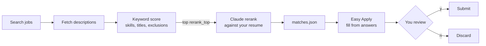

<div style="text-align: center;">
    <a href="https://www.youtube.com/channel/UCk2O3jSU3_B2MMGr8wLcAdw" target="_blank" title="CodeVoyage YouTube Channel">
        
    </a>
</div>

# 🤖 LinkedIn Interaction

[](LICENSE)

Selenium automation for your own LinkedIn account, split into six modules behind one CLI and Python package.

| Module | What it does | CLI |
|---|---|---|
| `communication` | send messages, list the inbox, read and reply to threads | `message send / inbox / read / reply` |
| `connection` | connect from a profile, invite a whole people-search (the original bot), accept invitations | `connect profile / search / accept` |
| `social` | follow people and companies, react to posts, comment | `social follow / react / comment` |
| `posts` | publish text posts, read the feed | `post create / feed` |
| `job_matching` | search jobs, keyword-filter them, rerank the best with Claude against your resume | `jobs match` |
| `job_applying` | Easy Apply from your answers map, stopping at review for your y/N | `jobs apply` |

## 🚨 Read this first

Automating LinkedIn breaks its User Agreement, and LinkedIn restricts accounts it catches. Use at your own risk.

- **Stay under ~80 connection requests a week.** Every write action has a per-run cap in `[limits]`.
- The bot waits a random interval between actions (set in `[pacing]`).
- Every write runs only when you give the command explicitly. `jobs apply` also asks before each submission.

## 🛠 Install

You need Python 3.11+ and Chrome; Firefox works too, see `[browser]`. Selenium Manager downloads the matching driver automatically.

```bash
git clone https://github.com/OfficialCodeVoyage/LinkedIn_Auto_Connector_Bot.git
cd LinkedIn_Auto_Connector_Bot
python3 -m venv venv && source venv/bin/activate
pip install -e .
cp config.example.toml config.toml   # then edit; config.toml is git-ignored
```

Log in once. The browser profile in `~/.linkedin-interaction/` keeps the session, so later runs skip the login. If `LINKEDIN_USERNAME` and `LINKEDIN_PASSWORD` are set in the environment, they're typed in for you. 2FA and captchas are always yours to complete in the window.

```bash
linkedin-interaction login
```

## 🚀 Usage

```bash
# Connections
linkedin-interaction connect search                       # invite everyone in connection.search_url
linkedin-interaction connect search --url "<people search URL>" --max 10 --follow
linkedin-interaction connect profile https://www.linkedin.com/in/someone/ --note "Hi …"
linkedin-interaction connect accept --max 20

# Communication
linkedin-interaction message inbox --unread
linkedin-interaction message read "Jane Doe"             # participant name as shown in the inbox, or a thread URL
linkedin-interaction message send https://www.linkedin.com/in/someone/ "Thanks for connecting!"
linkedin-interaction message reply "Jane Doe" - < reply.txt

# Social interaction
linkedin-interaction social follow https://www.linkedin.com/company/anthropic/
linkedin-interaction social react https://www.linkedin.com/feed/update/urn:li:activity:<id>/ --type celebrate
linkedin-interaction social comment https://www.linkedin.com/feed/update/urn:li:activity:<id>/ "Great write-up"

# Posts
linkedin-interaction post feed --limit 5
linkedin-interaction post create - < post.md

# Jobs
linkedin-interaction jobs match                 # writes matches.json and prints a ranked list
linkedin-interaction jobs apply --min-score 75  # Easy Apply to the saved matches, one review prompt each
linkedin-interaction jobs apply https://www.linkedin.com/jobs/view/<id>/
```

Global flags: `--config PATH`, `--headless`, `-v`. Text arguments accept `-` to read from stdin. `--max` can only lower a cap from `[limits]`, never raise it.

### Searching for people to connect with

1. Search LinkedIn for the people you want (e.g. "Tech Recruiter"), choose the **People** filter, and add location or industry filters.
2. Copy the URL into `connection.search_url`, or pass it with `--url`.
3. Set `connection.note` to at most 300 characters, or leave it empty to send invitations without a note. If LinkedIn blocks the note (free accounts get only a few personalized invitations a month), that person is skipped. The invitation is never sent silently without the note.

### Job matching and applying



- **Keyword score (0–1):** 70% weighted coverage of `matching.skills` plus 30% whether a `matching.titles` phrase appears in the job title. Any `matching.exclude` term drops the job.
- **Claude rerank (0–100):** runs `claude -p` once per job on the top `rerank_top` jobs. It uses your Claude Code login, so you need no API key. The call is lean: no tools, MCP servers or skills, about $0.01 per job. Your resume (`.pdf`, `.md` or `.txt`) is read locally and goes only into that prompt. Use `--no-rerank` for keyword scoring only.
- **Easy Apply:**
  - The browser must be visible, because you review every application before it's submitted.
  - Fields that are already filled stay as they are. Empty fields are filled from `[applying.answers]`, where the longest key contained in the question wins.
  - When a required question has no answer, the run pauses so you can fill it in the browser.
  - At the review step it prints every question and answer and asks `Submit application? [y/N]`. Anything other than `y` discards the draft.

## 🧩 Python library

```python
from linkedin_interaction.config import load_settings
from linkedin_interaction.session import Session
from linkedin_interaction import communication, job_matching

settings = load_settings()
with Session(settings) as session:
    session.login()
    for convo in communication.list_conversations(session, unread_only=True):
        print(convo.participants, convo.snippet)
    matches = job_matching.match_jobs(session, settings)
```

The layout:
- `session.py` owns the browser, login, waits, random pauses and per-run caps (`Session.spend` runs right before each irreversible click).
- Each feature module keeps its own LinkedIn selectors at the top of its file, so a LinkedIn UI change touches only one module.

## 🧠 AI agent mode (LinkedIn MCP)

You can also drive LinkedIn from an AI agent (Claude Code, Codex, Cursor, …) instead of the CLI:
- `.mcp.json` registers [stickerdaniel/linkedin-mcp-server](https://github.com/stickerdaniel/linkedin-mcp-server) as the `linkedin` MCP server.
- `.agents/skills/linkedin-mcp/` and `.claude/skills/linkedin-mcp/` contain its skill. `skills-lock.json` pins the source, and `npx skills experimental_install` restores it.

To set it up:
1. Install [uv](https://docs.astral.sh/uv/).
2. Run `uvx mcp-server-linkedin@latest --login` once; the session is stored in `~/.linkedin-mcp/`.
3. Approve the project MCP server in your agent.

The MCP server covers profile, company, job, feed and inbox reads, plus `send_message` and `connect_with_person`. Posting, reactions, comments, follows and Easy Apply need the CLI.

## 🧪 Development

```bash
pip install -e '.[dev]'
pytest
```

## 📄 License

MIT. See [LICENSE](LICENSE). Originally created by [Pavlo Bondarenko](https://www.linkedin.com/in/mrbondarenko/).
